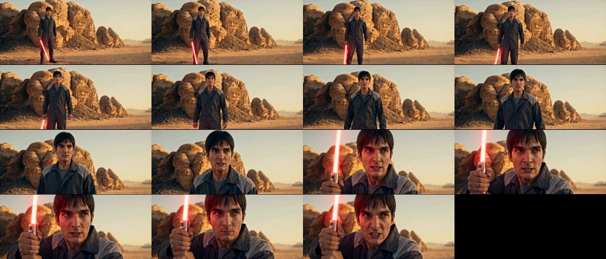

# video-filmstrip



An Antigravity skill and zero-dependency Python + FFmpeg CLI for generating Extracted Frames, a 4-column Filmstrip Grid, an Average Color Barcode, and an Average RGB CSV from any video file.

## Outputs

Running the tool on `<video>.mp4` writes a `<prefix>_filmstrip/` folder (next to the video by default) containing:

- `frames/<prefix>-001.jpeg` ... — Extracted Frames at the source video's original resolution (default `1 fps`, unbadged).
- `<prefix>_grid.jpeg` — 4-column, 4K-wide (`3840px`) Filmstrip Grid (`960px` per tile, preserving aspect ratio) with a bottom-left Frame Badge (`16px` black 1-based frame index inside a circular white background) on every populated tile. Long videos whose grid height exceeds FFmpeg's `65500px` JPEG limit automatically split into numbered Grid Sheets (`<prefix>_grid-001.jpeg`, `<prefix>_grid-002.jpeg`, ...) with continuous numbering.
- `<prefix>_averagesRGB.jpeg` — Average Color Barcode (`1px` wide per frame × `715px` tall by default).
- `<prefix>_averagesRGB.csv` — Average RGB CSV recording per-frame mean RGB values (`frame,timestamp_sec,r,g,b`).

## Requirements

- **FFmpeg** (`ffmpeg` and `ffprobe` on `PATH`)
- **Python 3.10+** (standard library only — no `pip` packages required)

## CLI Usage

```powershell
python skills/video-filmstrip/scripts/generate_filmstrip.py path/to/video.mp4
```

### Options

| Flag | Default | Description |
| --- | --- | --- |
| `--output-dir` | `<video_dir>/<prefix>_filmstrip` | Destination output folder |
| `--prefix` | Input video stem | Filename prefix for all outputs |
| `--fps` | `1.0` | Frames per second to extract |
| `--cols` | `4` | Columns in the filmstrip grid |
| `--grid-width` | `3840` | Total grid width in pixels |
| `--barcode-height` | `715` | Barcode image height in pixels |
| `--barcode-stripe-width` | `1` | Barcode stripe width per frame in pixels |
| `--quality` | `2` | FFmpeg MJPEG quality (`2`–`31`, lower is better) |
| `--start` | — | Start offset in seconds (`-ss`) |
| `--duration` | — | Clip duration in seconds (`-t`) |
| `--no-frame-numbers` | `false` | Omit bottom-left Frame Badges from Grid Sheets |

## Installing as a Global Antigravity Skill

Copy `skills/video-filmstrip/` to `~/.gemini/config/skills/video-filmstrip/`:

```powershell
Copy-Item -Recurse -Force "skills\video-filmstrip" "$HOME\.gemini\config\skills\video-filmstrip"
```

## Running Tests

```powershell
python -m unittest discover -s tests -v
```
